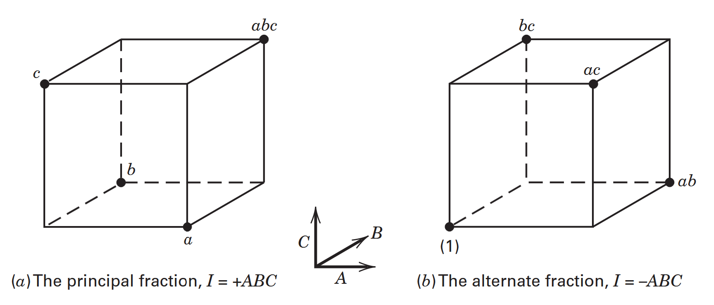
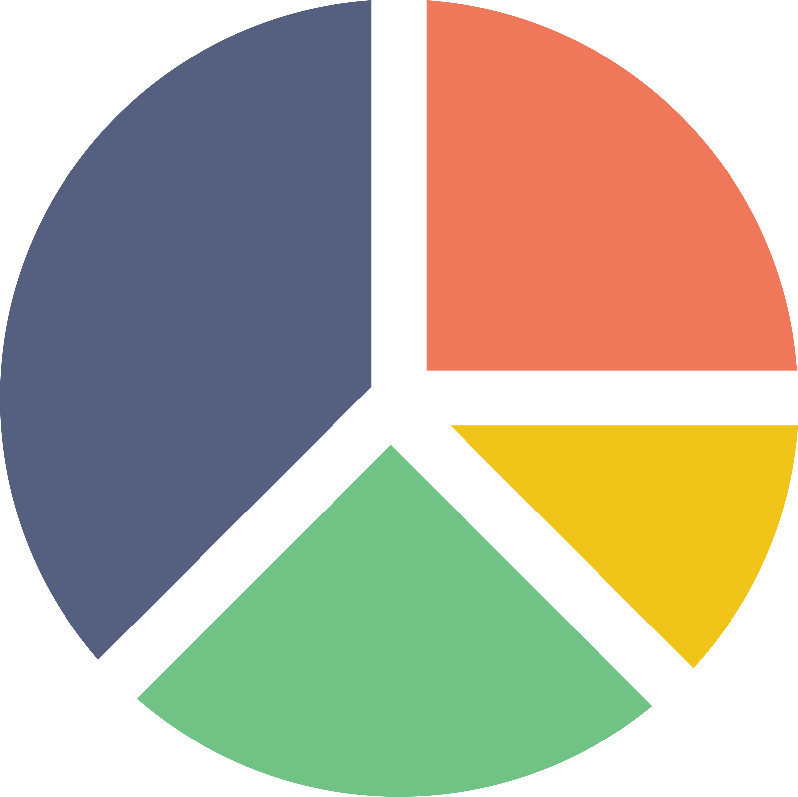
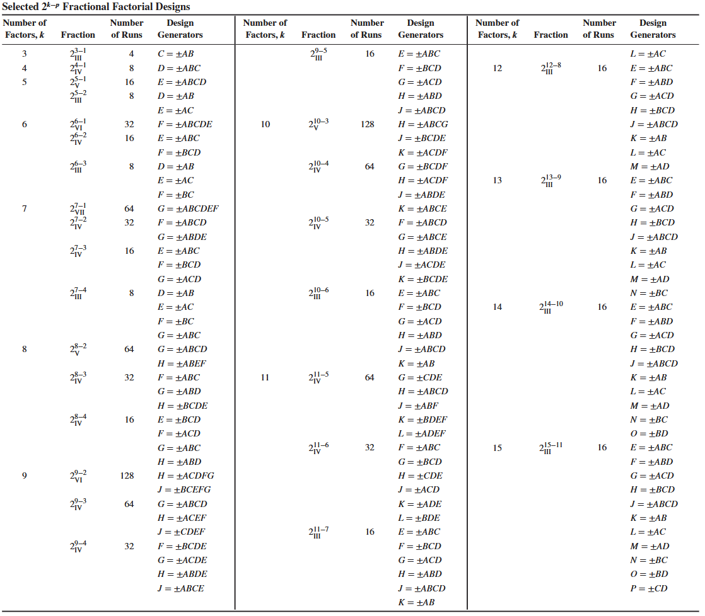
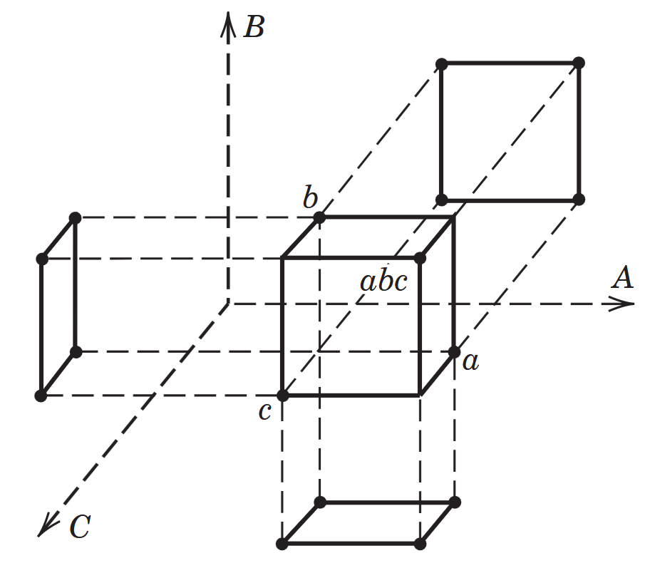

```{r}

library(tidyverse)

```

```{r}
# Funciones -----

yates <- function(...) {

    df_factores <- tibble::tibble(...)
  
  apply(df_factores, 1, function(fila) {
    activos <- names(fila)[fila == 1]
    if (length(activos) == 0) {
      "(1)"
    } else {
      tolower(paste0(activos, collapse = ""))
    }
  })
}


```


## Introducción al factorial fraccionado {.bloques}

:::::: {.columns}

::: {.column}

* Conforme aumenta el número de factores, [el número de corridas necesarias para completar una réplica crece rápidamente]{.hi}, y, por tanto, [la eficiencia del experimento decrece]{.hi}. 

* Son este tipo de situaciones las que motivan el uso de [experimentos factoriales fraccionados]{.hi}, en los que se espera ejecutar [solo una parte del experimento]{.hi} para obtener información que permita orientar la toma de decisiones con [mayor eficiencia]{.hi} que si se ejecutase completamente. 


:::


::: {.column}

```{r}

datos <- data.frame(k = 2:12) |> 
  dplyr::mutate(Tratamientos = 2^(k))

g1 <- datos |> 
  ggplot2::ggplot(aes(x = k, y = Tratamientos)) + 
  geom_line(color = "#C18A00", linewidth = 1.5) +
  geom_point(color = "#263247", size = 5) +
  scale_x_continuous(breaks = 2:12) +
  theme_bw(base_size = 15)


plotly::ggplotly(g1, height = 600, width = 850) |> 
  plotly::style(hoverlabel = list(font = list(size = 40))) |>
  plotly::layout(paper_bgcolor = "#F1F5F5",
                 plot_bgcolor  = "#F1F5F5",
                 font = list(size = 30),
                 xaxis = list(
                   title = list( font = list(size = 30)),
                   tickfont = list(size = 25)),
                 yaxis = list(title = list(font = list(size = 30)),
                              tickfont = list(size = 25)))

```


:::

::::::

## Factorial fraccionado {.bloques}

* Es lógico pensar que en presencia de muchos factores, realizar una réplica completa es una tarea casi imposible. Además de que [solo una pequeña parte de los grados de libertad se usaría para estimar efectos de orden inferior]{.hi}.

  * Todo esto bajo el amparo del principio de escasez de efectos. 

* Normalmente la persona investigadora puede asumir y de forma [muy razonable]{.hi} que las interacciones de orden superior son despreciables o bien, no interesan. 

* Bajo esta premisa, [los efectos principales y otros efectos de orden inferior]{.hi} se pueden obtener corriendo solamente una (o unas pocas) fracción(es). 

## Factorial fraccionado {.bloques}

:::::: {.columns}

::: {.column}

* Frente a las ventajas anteriormente mencionadas, estos diseños presentan una desventaja: [carecen de la información completa]{.hi}

* Haciendo la analogía con una mandarina, al tomar un gajo se puede encontrar que este [tenga o no semilla]{.hi}, y que con base en un solo gajo, se concluya sobre la cantidad de semillas en toda la mandarina.
  * Esta generalización puede ser peligrosa. Un gajo contiene información sobre la mandarina, pero no toda la información. La utilidad del gajo depende de qué características queremos estudiar y de qué tan representativo sea respecto al conjunto.

:::

::: {.column .img-fit}


:::

::::::

## Principios de los diseños fraccionados {.bloques}

* El éxito en el uso de diseños factoriales fraccionados se fundamenta en tres ideas clave:

* **1. Principio de la escasez de efectos (*Sparsity of effects*):**
  * Los sistemas o procesos suelen estar dominados principalmente por [pocos efectos]{.hi} principales e interacciones de bajo orden.
  * Esto implica que el sistema está dominado [por una pequeña fracción]{.hi} del total de efectos posibles.
  
  * **Ejemplo:** En un diseño $2^4$ existen 15 efectos posibles, pero según el principio de escasez se espera que solo unos pocos (por ejemplo, entre 2 y 4) sean verdaderamente activos
  
## Principios de los diseños fraccionados {.bloques}

* **2. Propiedad de proyección (*The projection property*):**
  * Los diseños factoriales fraccionados pueden [proyectarse en diseños completos y más potentes]{.hi} enfocados en el subconjunto de factores significativos.
  
* **3. Experimentación secuencial (*Sequential experimentation*):**
  * Permite [combinar las corridas de dos (o más) fracciones]{.hi} de forma secuencial para construir un diseño mayor y estimar con precisión los efectos e interacciones de interés.

# ¿Cuándo usarlos? {.bloques}

## Utilidad {.bloques}

* Existe una gran cantidad de factores de interés y se desea estudiar de manera simultánea, pero [con énfasis en los efectos principales y en las interacciones de orden inferior]{.hi}. 

* En las primeras etapas de investigación, cuando es necesario caracterizar un proceso, encontrando aquellas variables (factores) que [tienen un impacto]{.hi} sobre la calidad o eficiencia. 

## Utilidad {.bloques}

* Con los experimentos exploratorios se pretende [reducir la cantidad de factores]{.hi} en estudio a solo aquellos que verdaderamente tengan una implicación en la variable de respuesta del estudio experimental. 

* [No es usual que se usen]{.hi} para establecer el [tamaño del efecto]{.hi} de esos factores, [generalmente se usan para saber si el efecto existe]{.hi} y si tiene implicaciones prácticas sobre el contexto bajo el cual se desarrolla el experimento.

  * Esto para ser estudiado o investigado en posteriores experimentos. 


## En simple {.bloques}

* Con estos diseños se responde a la pregunta:

  * ¿Estos factores afectan a mi variable de respuesta?
  
* Para que compare, en cambio, en un experimento factorial completo la pregunta que se responde es: 

  * ¿Cuánto afectan estos factores a mi variable de respuesta? 
  
## En resumen ... {.bloques}

* Son experimentos que se utilizan para determinar [cuáles de los factores estudiados]{.hi} tienen un impacto sobre la variable de respuesta, para luego ser estudiados o abordados con otro tipo de experimento. 

* Por lo general, los diseños factoriales fraccionados se utilizan para identificar factores importantes y orientar experimentos posteriores de caracterización, mejora u optimización. 

* Esto es importante porque un diseño fraccionado puede formar parte de una estrategia de mejora:

* $Cribado \rightarrow Factorial completo \rightarrow RSM$

## En resumen ... {.bloques}

* Por tanto, tampoco se buscan modelos con "excelente" capacidad resolutiva en términos de la bondad de ajuste, por ejemplo, un valor de $R^2$ alto puede ser engañoso. 

* En diseños fraccionados con pocos grados de libertad, $R^2$ no debe utilizarse como criterio principal para identificar los efectos activos. La interpretación debe basarse en la estructura de alias, la jerarquía de efectos, la escasez de efectos y el análisis gráfico/estadístico apropiado

## En resumen ... {.bloques}

:::::: {.columns}

::: {.column}

* Se utilizan: 
  * Cuando se desea explorar [muchos]{.hi} factores.
  * Cuando el problema u objetivo son de tipo exploratorio.
  * Cuando se pretende quitar aquellos factores que en principio no son significativos.
  * Cuando los recursos no alcanzan para todas las corridas.
  * Cuando los diseños completos no son eficientes.

:::

::: {.column .img-fit}


:::

::::::

## En resumen ... {.bloques}

* Los diseños factoriales fraccionados permiten estimar efectos con un número reducido de corridas. Sin embargo, algunos efectos se encuentran confundidos entre sí, por lo que la interpretación individual de los efectos depende de la estructura de alias y de los supuestos realizados.

* ¿Qué factores parecen tener efectos importantes sobre la respuesta y cuáles requieren investigación adicional?

## Nomenclatura {.bloques}


* El experimento se escribe como: 

* $$2^{k-p}_R$$

* donde: 

  * $2:$ Cantidad de niveles
  * $k:$ Cantidad de factores
  * $p:$ Cantidad de generadores
  * $R:$ Resolución, por lo general es $III$, $IV$ y $V$.


## Nomenclatura {.bloques}

* [Generadores $p$]{.hi}: piezas de información que son necesarias para generar las fracciones (es la misma idea que en Bloqueo y confusión). 

* El número de fracciones solo puede ser potencia de 2. Esto es importante que lo tenga presente cuando haga experimentación secuencial. 

  * Cantidad de fracciones: $2^p$
  * Cantidad de tratamientos por fracción: $2^{k-p}$
  * Cantidad de tratamientos totales: $2^k$

## Resolución de un diseño {.bloques}

* Indica qué tan bien pueden estudiarse los efectos potencialmente importantes. 

* Coloquialmente: 

  * Qué tan grande debe ser la fracción que necesito para llegar a conclusiones adecuadas. 

## Resolución de un diseño {.bloques}

* **Definición formal:** Un diseño es de resolución $R$ si ningún efecto de $p$ factores está confundido (aliado) con otro efecto que contenga menos de $R - p$ factores.

* **Notación estándar:** Se utiliza un subíndice con números romanos; por ejemplo, la media fracción del diseño $2^3$ con relación definitoria $I = ABC$ es un diseño $2_{III}^{3-1}$.

* **Regla práctica:** La resolución de un diseño factorial fraccionado de dos niveles es igual al [número de letras de la palabra más corta]{.hi} en la relación definitoria.

## Tipos de Resolución: III y IV {.bloques}

* **1. Diseños de Resolución III ($2_{III}^{k-p}$):**
  * Ningún efecto principal está confundido con otro efecto principal.
  * Los efectos principales están confundidos con [interacciones de dos factores]{.hi}.
  * *Ejemplo:* El diseño $2^{3-1}_{III}$ con $I = ABC$.
  
* **2. Diseños de Resolución IV ($2_{IV}^{k-p}$):**
  * Ningún efecto principal está confundido con otro efecto principal **ni** con interacciones de dos factores.
  * Las interacciones de dos factores están confundidas entre sí.
  * *Ejemplo:* El diseño $2^{4-1}_{IV}$ con $I = ABCD$.
  
## Resolución V y Criterio de Elección {.bloques}

* **3. Diseños de Resolución V ($2_{V}^{k-p}$):**
  * Ningún efecto principal o interacción de dos factores está confundido con otro efecto principal o interacción de dos factores.
  * Las interacciones de dos factores se confunden con interacciones de tres factores.
  * *Ejemplo:* El diseño $2^{5-1}_V$ con $I = ABCDE$.

* **Criterio de preferencia:**
  * Se busca emplear diseños con la [mayor resolución posible]{.hi} para el nivel de fraccionamiento requerido.
  * Cuanto mayor es la resolución, [menos restrictivos]{.hi} son los supuestos sobre qué interacciones deben considerarse despreciables.

# ¿Qué pasa con los supuestos? {.bloques}

## Supuestos {.bloques}

* En diseños fraccionados puede no existir suficiente información para estimar el error experimental de forma independiente. Por ello, las pruebas formales de significancia y los diagnósticos de residuos deben interpretarse con cautela.

* Cuando se hace el análisis de fracciones individuales, recomiendo que se omita la comprobación de supuestos, hasta que incorpore más corridas mediante experimentación secuencial y/o tras seleccionar los efectos activos mediante el principio de parsimonia, enviando al error grados de libertad. 

# ¿Cómo fraccionar? {.bloques}

## Fracciones {.bloques}

* Sigue la misma idea de las estructuras de confusión.

* Un cambio [importante]{.hi} de nomenclatura se da en la definición del generador, en el caso de un $2^{3-1}$ para bloqueo y confusión el generador se describía como $ABC$, en fraccionamiento también se puede describir como $C = AB$.

  * Ambos enfoques son válidos, y generan el mismo diseño, pero con diferente secuencia de pasos. Los cuales se van a desarrollar en los slides a continuación. 

* Esto se debe a que $C\cdot C = A\cdot B \cdot C$ es decir $I =  ABC$. 

  * Donde $I$ es la columna identidad y $I=ABC$ es la relación definitoria. 

## Fracciones con $I=ABC$ {.bloques}

:::::: {.columns}

::: {.column}

```{r}

A <- B <- C <- c(-1, 1)

fracciones <- tidyr::expand_grid(A, B, C) |> 
  dplyr::mutate(Yates = yates(A, B, C), 
                I = C*C, 
                ABC = A*B*C) |> 
  dplyr::relocate(Yates, I, .before = A) |> 
  dplyr::mutate(ABC = kableExtra::cell_spec(ABC, 
                                            color = "white", 
                                            background = ifelse(ABC == 1, 
                                                                "#52796F", 
                                                                "#B45349")))
fracciones |> 
  knitr::kable(format = "html", escape = FALSE) |> 
  kableExtra::kable_styling()


```


:::

::: {.column}

```{r}


fracciones |> 
  dplyr::arrange(ABC) |>
  dplyr::mutate(Fracción = c(rep(1,4), rep(2,4))) |> 
  dplyr::relocate(Fracción, .before = I) |> 
  knitr::kable(format = "html", escape = FALSE) |> 
  kableExtra::kable_styling()

```


:::

::::::

## Fracciones con $C = \pm AB$ {.bloques}

:::::: {.columns}

::: {.column}

* Para este caso se parte de un experimento factorial completo $2^2$ (pues es el resultado matemático del $2^{3-1}$).

* La columna $C$ se obtiene del generador, en este caso $C = \pm AB$ (solo es un generador, pues viene del $2^1$).

* Cuando $C = -AB$ se genera la fracción 1 anterior, y cuando es $C = AB$ se genera la fracción 2.

:::

::: {.column}

```{r}

A <- B <- c(-1, 1)

fracciones2 <- tidyr::expand_grid(A, B)

fracciones2 |> 
  knitr::kable(format = "html", escape = FALSE) |> 
  kableExtra::kable_styling()

```


:::

::::::

## Fracciones con $C = \pm AB$ {.bloques}

:::::: {.columns}

::: {.column}

### Para la fracción 1 

$$C = -AB$$

Se le conoce como fracción [complementaria]{.hi}.

```{r}

A <- B <- c(-1, 1)

fracciones2 <- tidyr::expand_grid(A, B) |> 
  dplyr::mutate(C = -A*B, 
                Yates = yates(A, B, C))

fracciones2 |> 
  knitr::kable(format = "html", escape = FALSE) |> 
  kableExtra::kable_styling()


```


:::

::: {.column}

### Para la fracción 2 

$$C = AB$$

Se le conoce como fracción [principal]{.hi}.

```{r}


fracciones3 <- tidyr::expand_grid(A, B) |> 
  dplyr::mutate(C = A*B, 
                Yates = yates(A, B, C))

fracciones3 |> 
  knitr::kable(format = "html", escape = FALSE) |> 
  kableExtra::kable_styling()

```


:::

::::::

## Fracciones {.bloques}

:::::: {.columns}

::: {.column .img-fit}



:::

::::::


## ¿Cómo fraccionar? {.bloques}

:::::: {.columns}

::: {.column}

* La cantidad de fracciones y por ende el tamaño de las mismas es una decisión de la persona investigadora con base en el contexto. 

* ¿Es mejor una fracción grande? 

* ¿O dos fracciones pequeñas?

:::

::: {.column .img-fit}




:::

::::::

## ¿Cómo se escogen? {.bloques}

* Generalmente el proceso inicia seleccionando la fracción principal. 
  * Claramente esto no es un impedimento para seleccionar otras.

* Esta fracción es aquella que tiene todos sus generadores ($I = ABC$ o $C = AB$, en este ejemplo) con signos positivos. 

# Estructura de ALIAS {.bloques}

## Estructura de ALIAS  {.bloques}

* Cuando diseñe estos experimentos, revise la estructura de [ALIAS]{.hi}, ahí notará cuáles efectos estarán confundidos y de esa forma podrá tomar decisiones sobre la siguiente fracción a analizar. 

* En el ejemplo anterior, la estructura de ALIAS es la siguiente: 

* $A + BC$
* $B + AC$
* $C + AB$

## Estructura de ALIAS - ¿Cómo se obtiene? {.bloques}

* Se parte de la relación definitoria, en este caso $I=ABC$. Se debe multiplicar cualquier efecto por la relación definitoria, entonces:

  * $A\cdot I = A\cdot ABC$ lo que se simplifica como: $A=BC$

* Ocurre de forma similar con los demás efectos, por tanto: 

* $A + BC$
* $B + AC$
* $C + AB$

## Estructura de ALIAS {.bloques}

* En consecuencia, como $A + BC$ es imposible de diferenciar $A$ de $BC$, lo mismo ocurre con $B$ de $AC$ y de $C$ con $AB$.

  * ¡La misma idea que en bloqueo y confusión!

* Entonces, aún cuando su nombre o nomenclatura es $A$, lo que en realidad se está estimando es $A+BC$.

## ¿Cómo se interpreta? {.bloques}

* Básicamente, es necesario suponer que [solo uno o muy pocos]{.hi} en la cadena de ALIAS son responsables de estos efectos.

* Posteriormente en esta clase estudiaremos que como no podemos distinguir este efecto, por principios se asume que le pertenece a uno solo de los factores o interacciones (en este caso, a $A$); y que podemos recurrir a estrategias para separar ese efecto, de tal forma que podamos observar si, por ejemplo, en $A+BC$ el efecto está dominado por $A$, $BC$ o la combinación de ambos. 

* Esto se realiza mediante [experimentación secuencial]{.hi}, que consiste básicamente en escoger otra fracción que separa esa estructura aliada en particular. 

## Ejemplo {.bloques}

* Suponga una situación en la que usted ignora cuáles de todas las variables independientes de un problema son los verdaderamente importantes. 

* Usted identifica 6 factores y diseña un factorial fraccionado $2^{6-3}_{III}$. Se elige iniciar con la fracción principal. 

## Ejemplo {.bloques}

* Obtenga los generadores y a partir de ellos obtenga la relación definitoria (I).

  * En la Tabla 8.14 de la 9na Edición del libro Design and Analysis of Experiments, de Douglas Montgomery se muestran los generadores recomendados. 
  * Para el ejemplo que tratamos corresponden a: $D=AB$, $E=AC$ y $F=BC$.
  
* Por tanto, la relación definitoria es: 

* $I + ABD + ACE +BCF + A^2BCDE + AB^2CDF + ABC^2EF + A^2B^2DEF$

* $I + ABD + ACE + BCF + DEF + ABEF + ACDF + BCDE$

  * Se suelen acomodar por jerarquía. 

## Ejemplo {.bloques}

* Con base en esta relación definitoria $(I)$, obtenga la estructura de ALIAS. 

* $I + ABD + ACE + BCF + DEF + ABEF + ACDF + BCDE$

* $A + BD + CE + ABCF + ADEF + BEF + CDF + ABCDE$

* $B + AD + ABCE + CF + BDEF + AEF + ABCDF + CDE$

* $Etc...$ complete. 

* $AF + ...$

## Ejemplo {.bloques}

* ¿Qué quiere decir esta estructura? 

  * Que solo es posible estimar 7 contrastes independientes de efectos, el de $A$, $B$, $C$, $D$, $E$, $F$ y $AF$, pero cada contraste puede representar una cadena de alias. 
  
  * En mucho software, estos son seleccionados por ser los primeros en orden alfabético (además del principio de jerarquía).

  * Que para cada uno de esos efectos se supone que solo un factor o interacción (o unos pocos de ellos) es responsable. Por ejemplo, en $A + BD + CE + … ABCDE$, se podría suponer que solo $A$ es el responsable.
  
  * Si su hipótesis de trabajo es que $A$ no puede ser el responsable (o no el único) de ese efecto, sino que $BD$ está involucrado, puede recurrirse a la experimentación secuencial para separarlos y obtener la estimación individual de $A$ y una de $BD$.

## Generadores recomendados {.bloques}

:::::: {.columns}

::: {.column .img-fit}



:::

::::::


## Ejemplo {.bloques}

:::::: {.columns}

::: {.column}

* Para el ejemplo $2^{6-3}$, genere la fracción principal (aquella que tenga todos los generadores positivos).

* Para ello, primero genere un diseño $2^3$ (el resultado de $2^{6-3}$).

* >Nota: Aunque se le presenta el paso a paso de la solución, se espera que usted la realice.

:::

::: {.column}

```{r}

A <- B <- C <-  c(-1, 1)

diseno_2_3 <- tidyr::expand_grid(A, B, C) |> 
  dplyr::mutate(Yates = yates(A, B, C)) |> 
  dplyr::relocate(Yates, .before = A)

diseno_2_3 |> 
  knitr::kable(format = "html", escape = FALSE) |> 
  kableExtra::kable_styling()

```


:::

::::::

## Ejemplo {.bloques}

:::::: {.columns}

::: {.column}

* Ahora genere la fracción principal utilizando $D = AB$, $E =  AC$ y $F = BC$

:::

::: {.column}

```{r}

options(knitr.kable.NA = '')

diseno_2_3 |> 
  dplyr::mutate(D = NA, E = NA, F = NA) |> 
  dplyr::select(-Yates) |> 
  knitr::kable(format = "html", escape = FALSE, na = "") |> 
  kableExtra::kable_styling()

```


:::

::::::

## Ejemplo - Resuelto {.bloques}

:::::: {.columns}

::: {.column}

```{r}

diseno_2_3 |> 
  dplyr::mutate(D = A*B, E = A*C, F = B*C, 
                Yates = yates(A, B, C, D, E, F)) |> 
  knitr::kable(format = "html", escape = FALSE,na = "") |> 
  kableExtra::kable_styling()

```


:::

::::::

# Experimentación secuencial en el contexto de los fraccionados {.bloques}

## Experimentación secuencial {.bloques}

* En fraccionados, la idea de la experimentación secuencial es no jugarse todos los recursos en una primera apuesta, sino que el conocimiento se vaya construyendo por etapas. 

* En lugar de hacer un experimento muy grande y costoso desde el inicio, con los riesgos que esto puede conllevar, se puede hacer uno pequeño y con base en esa información, aumentar el diseño completando las corridas faltantes. 

## Experimentación secuencial {.bloques}

* Se utiliza para separar efectos potencialmente importantes que se encuentran confundidos con otros efectos.
* Se sigue la siguiente estrategia: 

  * Se ejecuta la primera fracción, por lo general la principal, al momento de analizarla se determina la necesidad de ejecutar una segunda fracción y cuál es esa fracción. 

  * Se sigue de esta manera hasta que el objetivo se haya completado.
  
## Experimentación secuencial {.bloques}

* Por ejemplo, se utilizaría, si se desea saber si el efecto aliado de $A + BC$ pertenece a $A$ o pertenece a $BC$, o una combinación de ambos.

* El uso secuencial de diseños factoriales fraccionados es muy útil, lo que a menudo conduce a [una gran economía y eficiencia]{.hi} en la experimentación.

## Experimentación secuencial {.bloques}

* Esta aplicación de factoriales fraccionados ocurre con frecuencia en situaciones de cribado de factores; es decir, hay relativamente muchos factores, pero se espera que solo unos pocos sean importantes.

* Generalmente, pero no exclusivamente, se emplean diseños de resolución $III$.

## Plegado (*Fold Over*) {.bloques}

* El plegado consiste en tomar la matriz de diseño de la fracción, generalmente la principal, y añadir un segundo diseño de corridas idénticas en magnitud pero donde se invierten los signos de todos los factores. 

* Esto también se conoce como [plegado completo]{.hi}, y la fracción resultante se le llama la [fracción complementaria]{.hi}. 

* En este tipo de plegado se aumenta la resolución del experimento, por ejemplo de $III$ a $IV$.

## ¿Cómo se construye para cualquier diseño? {.bloques}

* Para encontrar la fracción plegada de un diseño factorial $2^{k-p}$: 

  * **Paso 1:** Genere la matriz de diseño de la fracción de interés (la principal por ejemplo).
  
  * **Paso 2:** Duplique esa matriz, pero multiplique cada columna por $-1$.
  
  * **Paso 3:** La unión de la fracción original y su reflejo forma el **diseño plegado**.

* *Es posible que haya diseños sin un plegado completo.*

## Ejemplo {.bloques}

* Busque la fracción de plegado completo del diseño $2^{6-3}_{III}$ usado anteriormente. Utilice la fracción principal como la primera fracción. 

* Como ya sabe, los generadores de la fracción principal son $D=AB$, $E=AC$ y $F=BC$.

* Al obtener la plegada notará que los nuevos generadores son estos: $D = -AB$, $E = -AC$ y $F = -BC$. Esto es importante, procure entenderlo a cabalidad. 

## Ejemplo {.bloques}

:::::: {.columns}

::: {.column}

### Fracción principal

```{r}

frac_prin <- diseno_2_3 |> 
  dplyr::mutate(D = A*B, E = A*C, F = B*C, 
                Yates = yates(A, B, C, D, E, F)) 

frac_prin |> 
  dplyr::mutate(
    dplyr::across(c(A, B, C, D, E, F), 
                  ~ kableExtra::cell_spec(., 
                                          color = "white", 
                                          background = ifelse(. == 1,
                                                              "#52796F", 
                                                              "#B45349")))) |>
  knitr::kable(format = "html", escape = FALSE,na = "") |> 
  kableExtra::kable_styling()

```

:::


::: {.column}

### Fracción plegada

```{r}

frac_pleg <- frac_prin |> 
  dplyr::mutate(across(where(is.numeric), ~. *-1), 
                Yates = yates(A, B, C, D, E, F))

frac_pleg |> 
  dplyr::mutate(
    dplyr::across(c(A, B, C, D, E, F), 
                  ~ kableExtra::cell_spec(., 
                                          color = "white", 
                                          background = ifelse(. == 1,
                                                              "#52796F", 
                                                              "#B45349")))) |>
  knitr::kable(format = "html", escape = FALSE,na = "") |> 
  kableExtra::kable_styling()

```

:::

::::::


## Ejemplo - Diseño plegado completo {.bloques}


:::::: {.columns}

::: {.column style="font-size: 0.63em;"}

```{r}

frac_prin |> 
  rbind(frac_pleg) |> 
  dplyr::mutate(
    dplyr::across(c(A, B, C, D, E, F), 
                  ~ kableExtra::cell_spec(., 
                                          color = "white", 
                                          background = ifelse(. == 1,
                                                              "#52796F", 
                                                              "#B45349"))), 
    Fracción = c(rep("Principal", 8), rep("Complementaria", 8))) |>
  knitr::kable(format = "html", escape = FALSE,na = "") |> 
  kableExtra::kable_styling()

```


:::


::: {.column width="70%"}

* El diseño completo se obtiene uniendo las dos fracciones. La idea que hay detrás de esta estrategia es que usted [ejecute y analice la fracción principal (u otra)]{.hi} para luego [escoger una segunda fracción]{.hi} que le permita obtener más información, pero de forma estratégica. En este caso, y para el ejemplo, esa fracción fue la complementaria. 

  * Note, además, que la matriz de la izquierda es una matriz espejo.

* No obstante, también [es totalmente plausible]{.hi} que usted decida realizar un plegado sobre uno de los efectos de interés. Por ejemplo, plegar sobre $A$. Lo cual vamos a desarrollar a continuación.

:::

::::::

## Ejemplo - Plegado sobre $A$ {.bloques}

* Busque la fracción que pliega sobre $A$ en el diseño $2^{6-3}_{III}$. Utilice la fracción principal como su primera fracción.  

* Vamos a diseñar dicha fracción y vamos a invertir los signos de $A$, para luego deducir los generadores del diseño. 

  * Adelanto: los generadores de ese diseño son $D=-AB$, $E=-AC$ y $F = BC$. 

* Finalmente, se unen las dos fracciones y se analizan. 

## Ejemplo - Plegado sobre $A$ {.bloques}

:::::: {.columns}

::: {.column}

### Fracción principal

```{r}

frac_prin <- diseno_2_3 |> 
  dplyr::mutate(D = A*B, E = A*C, F = B*C, 
                Yates = yates(A, B, C, D, E, F)) 

frac_prin |> 
  dplyr::mutate(
    dplyr::across(c(A, D, E), 
                  ~ kableExtra::cell_spec(., 
                                          color = "white", 
                                          background = ifelse(. == 1,
                                                              "#52796F", 
                                                              "#B45349")))) |>
  knitr::kable(format = "html", escape = FALSE,na = "") |> 
  kableExtra::kable_styling()

```

:::


::: {.column}

### Fracción plegada sobre A

```{r}

frac_plegA <- frac_prin |> 
  dplyr::mutate(A = -A, 
                Yates = yates(A, B, C, D, E, F))

frac_plegA |> 
  dplyr::mutate(
    dplyr::across(c(A, D, E), 
                  ~ kableExtra::cell_spec(., 
                                          color = "white", 
                                          background = ifelse(. == 1,
                                                              "#52796F", 
                                                              "#B45349")))) |>
  knitr::kable(format = "html", escape = FALSE,na = "") |> 
  kableExtra::kable_styling()

```

:::

::::::

## Plegado para separar una cadena de alias {.bloques}

* El [plegado completo]{.hi} consiste en agregar una segunda fracción en la que se invierten los signos de todos los factores. En un diseño de Resolución $III$, un plegado completo permite separar los efectos principales de las interacciones de dos factores con las que estaban confundidos y produce un diseño combinado de Resolución $IV$.

* Sin embargo, cuando se dispone de un diseño de Resolución $IV$, los efectos principales ya están separados de las interacciones de dos factores. El problema puede estar ahora en que algunas interacciones de dos factores permanecen confundidos entre sí.

## Plegado para separar una cadena de alias {.bloques}

:::::: {.columns}

::: {.column}

* En este caso, no necesariamente es conveniente realizar un [plegado completo]{.hi}. Podemos construir una segunda fracción invirtiendo los signos de uno o más factores con el objetivo de romper cadenas de alias específicas.

* Por tanto, el plegado debe entenderse como una estrategia de [experimentación secuencial]{.hi}:

$$
\text{Primer experimento}
\rightarrow
\text{identificación de alias de interés} \\
\rightarrow
\text{segundo experimento}
\rightarrow
\text{separación de efectos}.
$$

* La elección de los factores cuyos signos se invierten depende de la estructura de alias del diseño y del objetivo del experimentador.

:::

::::::

## ¿Qué tipo de plegado necesito? {.bloques}

:::::: {.columns}

::: {.column}

| Situación                                                             | Estrategia                        |
| --------------------------------------------------------------------- | --------------------------------- |
| Resolución III: principales confundidos con interacciones de dos factores | *Plegado completo*                   |
| Resolución III: interés particular en un factor                       | *Plegado sobre un factor*          |
| Resolución IV: interacciones de dos factores confundidas entre sí         | *Plegado sobre uno o más factores* |
| Solo algunas cadenas de alias son de interés                          | *Plegado parcial*                |

> El plegado no se realiza simplemente para "aumentar la resolución". Se utiliza para obtener información adicional y romper determinadas estructuras de alias.

:::

::::::

## Experimentación secuencial {.bloques}

:::::: {.columns}

::: {.column}

* La mayoría de software ordena sus fracciones de esta manera: 

  * Tome el diseño $2^{6-3}_{III}$ y realice una matriz de Yates con sus generadores.

* Esto le puede servir para ubicar y generar fracciones más rápidamente. Tome en cuenta que esta construcción la hicimos bajo la premisa de que la primera fracción a ejecutar es la principal y que esto puede cambiar. 

* En la tabla de la izquierda se presentan las fracciones que hemos encontrado en el desarrollo de estos ejemplos.  

:::

::: {.column}

```{r}

D <- E <- F <- c(-1, 1)

orden_frac <- tidyr::expand_grid(D, E, F) |> 
  dplyr::arrange(F, E, D) |> 
  dplyr::mutate(No = 1:8, Yates = yates(D, E, F)) |> 
  dplyr::relocate(No, Yates, before = -1) |> 
  dplyr::mutate(Fracción = case_when(
    (D == -1 & E == -1 & F == -1) ~ "Complementaria",
    (D == -1 & E == -1 & F == 1) ~ "Sobre A",
    (D == 1 & E == 1 & F == 1) ~ "Principal"))

orden_frac |> 
  dplyr::mutate(
    dplyr::across(c(D, E , F), 
                  ~ kableExtra::cell_spec(., 
                                          color = "white", 
                                          background = ifelse(. == 1,
                                                              "#52796F", 
                                                              "#B45349")))) |>
  knitr::kable(format = "html", escape = FALSE,na = "") |> 
  kableExtra::kable_styling()

```


:::

::::::

## Ejercicio {.bloques}

* A realizarse de forma sincrónica o asincrónica, al juicio de la persona docente. 

* Para el diseño $2^{6-3}_{III}$, encuentre la fracción correspondiente al plegado sobre $B$ y sobre $D$. Para cada caso, determine los nuevos generadores.
  
  * En la tabla anterior, indique a cuál número de fracción corresponde cada fracción. 
  
# Propiedad de la proyección {.bloques}
  
## Propiedad de la proyección {.bloques}

* La [propiedad de la proyección]{.hi} es una de las ideas clave para el uso exitoso de los diseños factoriales fraccionados. 

* Consiste en la capacidad de un diseño fraccionado para "colapsar" o proyectarse en diseños factoriales completos (a veces con réplicas) cuando se consideran solo los subconjuntos de factores que resultan ser potencialmente activos.

## Propiedad de la proyección {.bloques}

* La capacidad de proyección de un diseño depende directamente de su resolución $(R)$

* Cualquier diseño factorial fraccionado de resolución $R$ contiene diseños factoriales completos en cualquier subconjunto de $R-1$ factores.

* Por ejemplo, un diseño $2^{3−1}$  de resolución $III$ se proyecta en un diseño factorial completo $2^2$ en cada subconjunto de dos factores.

## Propiedad de la proyección {.bloques}

:::::: {.columns}

::: {.column}

* En los diseños de media fracción, la propiedad funciona de la siguiente manera:

  * Se proyecta en un factorial completo en cualquier combinación de $k-1$ factores de los $k$ originales.
  
  * Puede proyectarse en dos réplicas de un factorial completo en cualquier subconjunto de $k-2$ factores.

  * Puede proyectarse en cuatro réplicas de un factorial completo en cualquier subconjunto de $k-3$ factores, y así sucesivamente

:::

::: {.column .img-fit}



:::

::::::

## Propiedad de la proyección {.bloques}

* En fracciones más pequeñas, como las de un cuarto $2^{k-2}$, el diseño se proyecta en un factorial completo en cualquier subconjunto de factores $r \le k-p$, siempre y cuando ese subconjunto de factores [no forme una palabra en la relación definitoria]{.hi} del diseño.

## Propiedad de la proyección {.bloques}

* Esta propiedad es extremadamente valiosa en [experimentos de cribado]{.hi} (*screening*). 

  * Generalmente, al inicio de un proyecto se investigan muchos factores, pero debido al [principio de escasez de efectos]{.hi}, es probable que solo unos pocos sean "activos" o realmente importantes. 

* La propiedad de proyección permite que, una vez identificados los factores potencialmente inactivos y eliminados del análisis, los datos restantes representen un experimento factorial completo en los factores retenidos.

* Cualquier diseño de Resolución $R$ se proyecta en un diseño factorial completo $2^{R-1}$ en cualesquiera $R-1$ factores. 

## Ejemplo {.bloques}

:::::: {.columns}

::: {.column}

* Suponga que se ha diseñado un experimento factorial fraccionado $2^{4-1}_{IV}$ con $I=ABCD$.

* Analice el experimento y genere un diagrama de Pareto de los efectos. 

:::

::: {.column}

```{r}

A <- B <- C <- c(-1, 1)

ejercicio <- tidyr::expand_grid(A, B, C) |> 
  dplyr::mutate(D = A*B*C, 
                Yates = yates(A, B, C, D), 
                Respuesta = c(45, 75, 45, 80, 
                              100, 60, 65, 96)) |> 
  dplyr::relocate(Yates, .before = A)

ejercicio |> 
  dplyr::mutate(
    dplyr::across(c(A, B, C, D), 
                  ~ kableExtra::cell_spec(., 
                                          color = "white", 
                                          background = ifelse(. == 1,
                                                              "#52796F", 
                                                              "#B45349")))) |>
  knitr::kable(format = "html", escape = FALSE,na = "") |> 
  kableExtra::kable_styling()

```


:::

::::::

## Ejercicio {.bloques}

:::::: {.columns}

::: {.column}

```{r}

options(knitr.kable.NA = '*')

modelo <- lm(Respuesta ~ A*B*C*D,
             data =  ejercicio)

broom::tidy(modelo) %>% 
  dplyr::mutate(across(where(is.numeric), ~ round(., 2))) |> 
  dplyr::filter(!is.na(estimate)) |> 
  dplyr::mutate(term = c("Intercepto", "A", "B", "C", "D", "AB", "AC", "AD")) |> 
  setNames(c("Término", "Estimado", "EE", "Valor T", "Valor P")) |> 
  knitr::kable(format = "html", escape = FALSE,na = "") |> 
  kableExtra::kable_styling()

```

:::

::: {.column}

```{r}

efectos <- coef(modelo)[-c(1, 9:16)] |> 
  setNames(c("A", "B", "C", "D", "AB", "AC", "AD"))

df_efectos <- data.frame(factor = names(efectos),
                         efecto = abs(efectos)) |> 
  dplyr::mutate(factor = reorder(factor, efecto))

g2 <- ggplot(df_efectos, aes(x = factor, y = efecto)) +
  geom_bar(stat = "identity", fill =  "#B45349") +
  coord_flip() +
  labs(x = "Efecto", y = "Magnitud",
       title = "Pareto de efectos factoriales") +
  theme_bw(base_size = 20)

plotly::ggplotly(g2, height = 600, width = 850) |> 
  plotly::style(hoverlabel = list(font = list(size = 40))) |>
  plotly::layout(paper_bgcolor = "#F1F5F5",
                 plot_bgcolor  = "#F1F5F5",
                 font = list(size = 30),
                 xaxis = list(
                   title = list( font = list(size = 30)),
                   tickfont = list(size = 25)),
                 yaxis = list(title = list(font = list(size = 30)),
                              tickfont = list(size = 25)))

```


:::

::::::

## Ejercicio {.bloques}

:::::: {.columns}

::: {.column}

* Como puede notar, el modelo está dominado por $A$, $C$ y $D$. 

* [Buenas noticias]{.hi}, podemos proyectar el diseño en un factorial completo $2^3$ con una sola réplica. 

* El diseño original, de resolución $IV$ se puede proyectar en un diseño completo $4-1 = 3$ factores, en este caso, de una sola réplica. 

:::

::: {.column}

```{r}

modelo <- lm(Respuesta ~ A*C*D,
             data =  ejercicio)

broom::tidy(modelo) %>% 
  dplyr::mutate(across(where(is.numeric), ~ round(., 2))) |> 
  dplyr::filter(!is.na(estimate)) |> 
  setNames(c("Término", "Estimado", "EE", "Valor T", "Valor P")) |> 
  knitr::kable(format = "html", escape = FALSE,na = "") |> 
  kableExtra::kable_styling()

```


:::

::::::

## Ejercicio integrador {.bloques}

* En este [enlace](https://stevenggoni.github.io/tutoriales_R/ejercicio_integrador_FF.html){target="_blank"} cuenta con un enunciado y datos para la realización de un ejercicio integrador para esta clase. 

## Cómo crear y analizar  este experimento en R {.bloques}

* En caso de que no quiera usar Minitab, por costo, licenciamiento u otras razones, se le provee de un tutorial en R para el diseño y análisis de experimentos factoriales fraccionados 

* Lo puede encontrar en este [enlace](https://stevenggoni.github.io/tutoriales_R/factorial_fraccionado_R.html){target="_blank"}.

## Bibliografía {.bloques}

:::: columns
::: {.column width="100%" style="font-size: 1.35em;"}

* Montgomery, D. C. (2020). Design and analysis of experiments (10.ª ed.). Wiley.
  * Capítulo 8.

:::
::::


## Diseño factorial fraccionado $2^{k-p}_R$ <br> II-1125 Estadística para Ingeniería Industrial III {.center}

### Gracias por su atención <br> Steven García Goñi<br>[steven.garciagoni\@ucr.ac.cr](mailto:steven.garciagoni@ucr.ac.cr) {.subtitle}

### Dudas o correcciones requeridas pueden solicitarse al correo