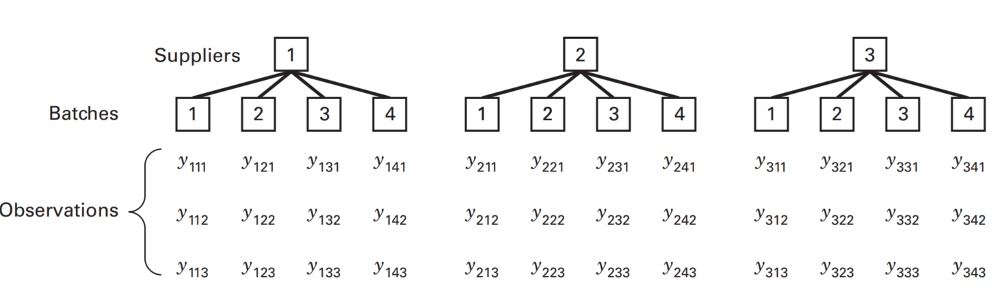
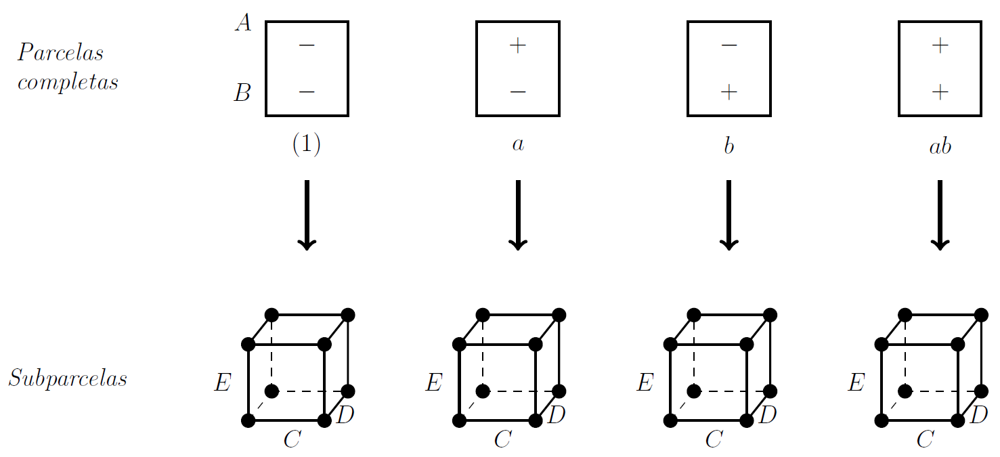
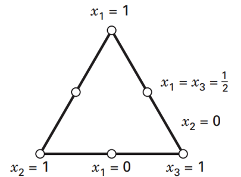

## Agenda {.bloques}

* Introducción
* Experimentos $3^k$ y mixtos
* Experimentos jerárquicos
* Experimentos robustos (Taguchi)
* Experimentos de cribado
* Experimentos con mezclas

## Introducción {.bloques}

* Además de los experimentos que ya conoce, hay muchos otros tipos de diseño experimental.

* Con esta sesión se pretende describir algunos tipos de diseños experimentales de uso regular, pero que no se abarcaron en el curso ni en esta área de conocimiento, con el propósito de que la persona estudiante reconozca cuándo son aplicables y las ventajas y desventajas de utilizarlos. 

## Introducción {.bloques}

* Algunos aspectos que influyen en la selección de un diseño de experimentos son: 

    * El objetivo.

    * La cantidad de los factores a valorar.

    * El número de niveles por factor.

    * Los efectos que interesa estudiar (causa - efecto).

    * El costo, el tiempo y precisión. 

## Experimentos $3^k$ {.bloques}

:::::: {.columns}

::: {.column}

* Se utilizan cuando hay varios factores que **naturalmente** se encuentran en tres niveles. Si las variables son numéricas, este experimento resulta bastante ineficiente, en el tanto hay otras alternativas mejores. 

* Preferiblemente se recomienda que no se usen más de 3 factores. Este diseño le permite estudiar si existe o no una curvatura en el modelo, pero solo le permite **detectarla**, no **describirla**.  
:::


::: {.column}

```{r}

library(tidyverse)

datos <- data.frame(k = 2:7) |>
  dplyr::mutate("2^k" = 2^k, "3^k" = 3^k) |>
  tidyr::pivot_longer(!k, names_to = "Tipo", values_to = "Tratamientos")


g1 <- datos |>
  ggplot(aes(x = k, y = Tratamientos, color = Tipo)) +
  geom_line() +
  geom_point() +
  scale_color_discrete(palette = c("#C18A00", "#263247")) +
  labs(
    title = "Comparación entre un 2^k y un 3^k",
    x = "Cantidad de factores",
    y = "Cantidad de tratamientos"
  ) +
  theme_bw(base_size = 15)

plotly::ggplotly(g1, height = 600, width = 850) |>
  plotly::style(hoverlabel = list(font = list(size = 40))) |>
  plotly::layout(
    paper_bgcolor = "#F1F5F5",
    plot_bgcolor = "#F1F5F5",
    font = list(size = 30),
    xaxis = list(
      title = list(font = list(size = 30)),
      tickfont = list(size = 25)
    ),
    yaxis = list(
      title = list(font = list(size = 30)),
      tickfont = list(size = 25)
    )
  )

```

:::

::::::

## Experimentos $3^k$ {.bloques}

* Considera $k$ factores con tres niveles cada uno, por tanto, tienen $3^k$ tratamientos.

* Requiere al menos de dos réplicas, para que haya grados de libertad para el error. 

* Por ejemplo, con un diseño $3^2$ se tendrían 9 tratamientos. 

* Un [experimento es mixto]{.hi} si una parte de los factores tiene una cantidad de niveles diferente a otras. Por ejemplo, en un experimento se decide probar dos niveles para los factores A y B y tres niveles para el C, de tal forma que el experimento sería un factorial $2^2\cdot 3$ y consistiría en 12 tratamientos. 

# Experimentos jerárquicos {.bloques}

## Diseño anidado {.bloques}

:::::: {.columns}

::: {.column}

Sucede, cuando por ejemplo los niveles del factor B son similares, pero no idénticos para cada nivel del factor A.



:::

::::::

## Diseño anidado {.bloques}

* En este ejemplo, los *suplidores* son el segundo nivel y los *batches* el primer nivel. 

* Los *batches* tienen la opción de ser un [factor aleatorio]{.hi}, pues se encuentran anidados en los *suppliers*. 

* En cambio, los *suppliers* solo pueden ser fijos, pues no se encuentran anidados en ningún otro nivel. 

* Puede haber niveles con menos tratamientos/observaciones.

* Esto lo convierte en un diseño [no balanceado]{.hi}. 
    * Lo que desde luego afecta la asignación de grados de libertad, y por ende, la definición de significancia estadística. 


## Diseño anidado {.bloques}

* Se pueden anidar experimentos, factoriales completos, por ejemplo; dentro de relaciones de jerarquía. 

* Por ejemplo, en 3 fábricas diferentes se aplica un experimento factorial $2^4$.
    * ¿Quién es el nivel 2 y el nivel 1?

## Momento reflexión {.bloques}

* Ahora bien, ¿en qué se diferencia una relación jerárquica con el bloqueo?

* Como ya ha aprendido, el bloque es una variable que no interesa, que tiene que estar muy relacionada con la variable de respuesta y que no puede interactuar con los otros factores. 

* En clases anteriores se le mencionó que si la variable si interesa o si interactúa, que no debía ser un bloque, sino otro tipo de variable. 
    * Una opción es convertirse en una relación jerárquica. 

## Diseños de parcelas divididas {.bloques}

* Ocurre cuando por, recursos generalmente, no es factible aleatorizar completamente el orden de las corridas.

* Es una generalización del experimento factorial, conocido como diseño de parcelas divididas (Split-plot design).

* ¿Cuándo se usa?
    * Cuando los factores (algunos) son difíciles de cambiar (*HTC: Hard-to-Change*).

## Diseños de parcelas divididas {.bloques}

* Algunos factores clásicos que son difíciles de cambiar (HTC): 
    * Temperatura
    * Tiempo
    * Posiciones
    * Entre otros

## Diseños de parcelas divididas {.bloques}

:::::: {.columns}

::: {.column .img-fit}



:::

::::::

## Experimentos robustos {.bloques}

* Fue originado por el ingeniero japonés Genichi Taguchi. 

* No fue aceptado, sobre todo por sus pares de occidente, hasta el éxito en las industrias automotriz y electrónica de los japoneses. 

* Es también conocido como diseño de parámetros o diseño robusto.

## Experimentos robustos {.bloques}

* Decimos que un [proceso o producto]{.hi} es robusto cuando su funcionamiento es consistente al [exponerse a las condiciones cambiantes del medio]{.hi}. 

* El objetivo del diseño de parámetros robusto es lograr, como su nombre indica, productos y procesos robustos.

* Por parámetro se refiere a los parámetros del sistema, es decir, [son los factores o variables del proceso]{.hi}.

    * Vamos a entender como sinónimos los términos “factor” y “parámetro”.

## Experimentos robustos {.bloques}

* El experimento es un [diseño robusto]{.hi} cuando consideran [factores de ruido]{.hi}, con respecto a los cuales se quiere lograr un proceso o producto robusto. 

* La robustez se refiere a hacer un producto o proceso insensible o resistente a factores de ruido que NO son controlables. 

* La idea de Taguchi en simple es que en el DdE prácticamente **todo** se debe controlar, pero en la práctica los procesos y productos están sometidos a esas condiciones que se controlaron en el experimento.

## Ejemplo {.bloques}

* Los M&M’s son pequeños trozos de chocolate que están revestidos con azúcar. 

* El slogan de la marca es: 
    * “El chocolate se derrite en tu boca, no en tu mano”.

* La historia, sea real o no (no es el objetivo de esta sesión), dice que en la Guerra Civil Española los soldados recibían pastillas de chocolate recubiertas, idea que luego se convirtió en M&M’s, para que:

    * No se derritieran en las manos o las bolsas de los pantalones
    * Se conservaran durante más tiempo, pues el azúcar absorbe humedad.

## Ejemplo {.bloques}

* Con base en la promesa dada en el slogan, el producto debe hacerse [robusto]{.hi} a una condición que NO puede controlarse: 
    
    * La temperatura

* Al recubrir el trozo de chocolate (cuyo punto de fusión se encuentra entre 50ºC y 55ºC) con azúcar (186 °C) [se hace que este producto sea “insensible” o “resistente” al factor de ruido temperatura]{.hi}.

## Experimentos robustos {.bloques}

* ¿Recuerda los experimentos jerárquicos? 

* Los experimentos de Taguchi con arreglo externo son experimentos jerárquicos: 

    * En el nivel 1: El arreglo interno (control)

    * En el nivel 2: El arreglo externo (ruido)

## Ventajas {.bloques}

* El diseño clásico no considera la posibilidad de minimizar el efecto de un factor de ruido sin tener que controlarlo directamente. 

* Con el diseño robusto es posible formular un proceso o producto que trabaje sobre el valor objetivo con la mínima variación, que sea insensible a los cambios de las condiciones de ruido externo, interno y/o deterioro. 

* Su énfasis es buscar siempre minimizar la varianza y al mismo tiempo llevar la media a su valor nominal. El diseño clásico solo se centra en la media. 


## Experimentos de cribado {.bloques}

* ¿Qué es cribado?

* Usemos una definición coloquial: 

    * El tamizado, cribado o colado es un método de separación útil para separar dos sustancias sólidas cuyas partículas sean de distinto tamaño.

* Por ejemplo: cernir una harina, colar un refresco, etc.

* En un marco sanitario se refiere a la realización de pruebas diagnósticas a personas, en principio sanas, para distinguir aquellas que están enfermas. 

## Experimentos de cribado {.bloques}

* En relación al DdE y haciendo la analogía con la definición en salud:

    * Sería un método para separar efectos activos (personas enfermas) de los inactivos (personas sanas). 

    * En resumen, se utilizan para encontrar aquellos factores que tengan efectos que verdaderamente tengan un impacto sobre la variable de respuesta.

## Algunos diseños: Plackett - Burman {.bloques}

* Para $N = 12, 20, 24, 28, 36$ resulta útil e interesante emplear diseños de Plackett – Burman. Se puede usar con otros valores de N. 

* Nótese que estos N no son una potencia de 2.
    * Si lo fuesen, sería lo mismo que un factorial fraccionado

* Dado que los diseños anteriores no pueden ser representados con cubos, se conocen también como diseños no geométricos.

## Algunos diseños: Cribado definitivo {.bloques}

* Son de resolución IV

* Se utilizan cuando interesan interacciones

* Incluyen puntos centrales

* Pueden estudiar curvaturas
	* Suelen ser precuela de RSM

* Se utilizan con variables continuas


## Experimentos con mezclas {.bloques}

* Son experimentos en los que se asume que la respuesta solo depende de las proporciones relativas de los ingredientes presentes en la cantidad de la mezcla.

* En un experimento con mezclas si el total permanece constante y el valor de la respuesta cambia cuando se introducen variaciones en las proporciones de los ingredientes, entonces el comportamiento de la respuesta se dice que es una función de la propiedad de la mezcla conjunta de los ingredientes.

## Experimentos con mezclas {.bloques}

* Son casos especiales de las RSM, donde los factores ahora son llamados [componentes]{.hi} y no son independientes de los otros componentes. 

* En un experimento factorial o en un diseño de superficies de respuesta convencional, se parte de que los niveles de cada factor son independientes de los niveles de los otros factores.

* Las proporciones tienen que encontrarse entre 0 y 1 y que la suma de ellas debe ser uno. 

* Por tanto, si se aumenta la cantidad de un ingrediente, se debe reducir la participación de los componentes restantes en esa misma proporción. 

## Experimentos con mezclas {.bloques}

* El objetivo del diseño de experimentos con mezclas es [cuantificar]{.hi} la influencia que tienen los diferentes componentes sobre la respuesta, tanto en forma individual como en su acción conjunta con otros componentes.

* Los experimentos con mezclas trabajan bajo el supuesto de que las características de calidad de la mezcla dependen de las proporciones con las que participan los ingredientes y no de la cantidad absoluta de ellos .

## Experimentos con mezclas {.bloques}

* Los diseños factoriales tradicionales no son aplicables, ya que su objetivo es medir el cambio en la respuesta cuando se varía el nivel de cada factor mientras que los otros niveles permanecen constantes (lo que no es posible en un experimento con mezclas). 

* Además, porque los polinomios estándar no son adecuados pues algunos de sus parámetros carecen de sentido, así como su incapacidad para mantener la cantidad total fija.

## Experimentos con mezclas {.bloques}

:::::: {.columns}

::: {.column}

* Existen tres diseños principales:

    * Simplex
        * Centroide 
        * Reticular
    * Vértices extremos

:::

::: {.column .img-fit}



:::

::::::

## Cierre de la sesión {.bloques}

* La exposición es representativa de experimentos de uso común, interesa en esta ocasión que usted reconozca otras formas de experimentar y advierta si los reductores de ruido o factoriales en dos niveles no alcanzan para una situación particular, lo que implica estudiar o buscar asesoría, porque la selección inadecuada de un diseño puede llevarlo a resultados inexactos o confusos.

* Espero haya disfrutado este curso. 

## Bibliografía {.bloques}

:::: columns
::: {.column width="100%" style="font-size: 1.2em;"}

* Las fuentes son variadas y no se considera necesario ahondar en ellas.

:::
::::

## Introducción a otros experimentos de alta complejidad <br> II-1125 Estadística para Ingeniería Industrial III {.center}

### Gracias por su atención <br> Steven García Goñi<br>[steven.garciagoni\@ucr.ac.cr](mailto:steven.garciagoni@ucr.ac.cr) {.subtitle}

### Dudas o correcciones requeridas pueden solicitarse al correo