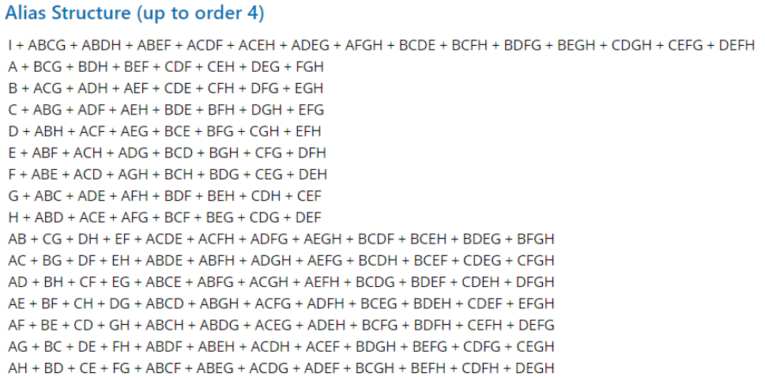
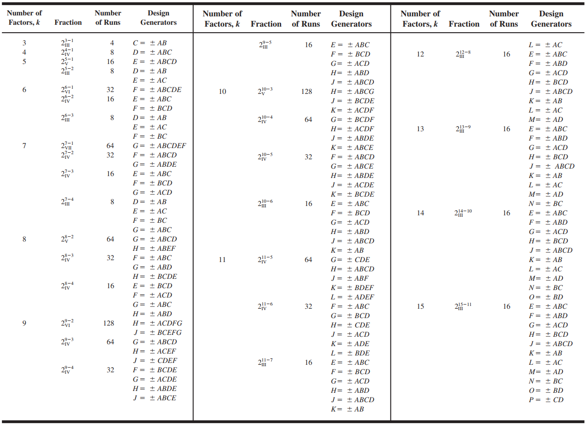

# Resumen

## Retomando conceptos

Un experimento es un estudio en el que el investigador manipula (en el buen sentido) las entradas o factores en estudio, en un ambiente controlado, con el fin de observar las variaciones resultantes sobre una o varias variables de repuesta. Una de las premisas más importantes de un estudio experimental es que supone que las asignaciones son aleatorias a los tratamientos, y que todas las unidades experimentales son iguales, **excepto** en el tratamiento que se les aplica.

Es esta característica de los experimentos es la que los diferencia de los demás estudios y la que le brinda un potencial distintivo para generar evidencia de relaciones causales. En síntesis:

*Se considera que únicamente los diseños experimentales son los que se acercan más a dar evidencias de tipo causal.*

## Factoriales fraccionados

Como se ha observado a lo largo del desarrollo de este curso, conforme aumenta el número de factores, el número de corridas requeridas para completar una réplica crece rápidamente y la eficiencia del experimento decrece (ver Figura 1). Es lógico determinar que en presencia de muchos factores realizar una réplica completa es una tarea casi imposible, además, solo una pequeña cantidad de los grados de libertad se utilizan para estimar los efectos principales y aquellos de orden inferior (dispersión de efectos). Normalmente el experimentador puede asumir y de forma razonable, que las interacciones de orden superior son despreciables, es decir, no interesan.

```{r fig.cap="Cantidad de corridas por réplica", fig.height=3.5, message=FALSE, echo=FALSE}

library(tidyverse)

data.frame(k = 2:12) %>% 
  dplyr::mutate(Corridas = 2^k) %>% 
  ggplot2::ggplot(aes(x = k, y = Corridas)) + 
  geom_line(color = "darkred") + 
  geom_point(size = 2) +
  geom_label(aes(label = Corridas)) +
  scale_x_continuous(breaks = 2:12) +
  theme_bw()

```

Bajo esta premisa, los efectos principales y los de las interacciones de orden inferior se pueden obtener corriendo solamente una **fracción** del experimento factorial completo. Esta estrategia es conocida como **diseños factoriales fraccionados**.

Estos experimentos, amplificadores de señal, son seleccionados cuando existe una gran cantidad de factores y se desean estudiar de manera simultánea, pero con énfasis en las interacciones de orden inferior. Son utilizados en las primeras etapas de investigación, cuando es frecuente que interese estudiar varios factores a la vez y algunas de sus interacciones. ¿Qué significa esto? Qué con este experimento nunca se va a poder determinar el efecto conjunto de los factores, sino que solamente es capaz de determinar cuáles de los factores seleccionados tienen un impacto sobre la variable de respuesta, para luego ser estudiados con otro tipo de experimento, por ejemplo un factorial completo u otros diseños de mayor complejidad.

A modo de analogía, piense que con los experimentos exploratorios se pretende reducir la cantidad de factores en estudio a solo aquellos que verdaderamente tengan una implicación (que sean significativos, pues, es decir, que **NO sean cero**) en la variable de respuesta del estudio experimental.

Con un experimento factorial fraccionado se pretende generar evidencia de causalidad, es decir, si verdaderamente existe el efecto de determinado factor (o su interacción) sobre la variable de respuesta. Nunca busca establecer el tamaño de ese efecto, solo si existe y si tiene **implicaciones prácticas** sobre el contexto bajo el cual se desarrolla el experimento.

Es decir, y de modo más simple, estos diseños responden a la pregunta: *¿Estos factores afectan mi variable de respuesta?* Si se hiciese la analogía con un experimento factorial completo, la pregunta sería: *¿Cuánto afectan estos factores a mi variable de respuesta?*

Para el desarrollo de un diseño factorial fraccionado se debe tomar en cuenta:

- El principio de dispersión de efectos
- La propiedad de proyección
- La experimentación secuencial

Repase estos conceptos por cuenta propia con el material disponible en el aula virtual, inclyendo libros de texto.

### La numeración de las fracciones

Suponga un experimento $2^{8-4}_{IV}$ con los siguientes generadores:

- $E = BCD$

- $F = ACD$

- $G = ABC$

- $H = ABD$

La nomenclatura es la misma que en confusión, con un ligero cambio:

- $2^k = 2^8 = 256$: Cantidad de tratamientos totales

- $2^p = 2^4 = 16$: Cantidad de fracciones (en confusión era cantidad de bloques)

- $2^{k-p} = 2^{8-4} = 2^4 = 16$: Tamaño de cada fracción. También se pueden obtener como $\frac{256}{16} = 16$.

- $_{IV}$: resolución del experimento.

Con base en los anteriores generadores se construye la relación definitoria, la cual es el conjunto total de términos que se mantienen constantes para definir la fracción en un diseño factorial fraccionado. Es importante porque con esta se calcula la estructura de ALIAS que describe la **confusión** existente en los diseños factoriales fraccionados.

Por tanto, la relación definitoria es:

$$I = BCDE = ACDF = ABCG = ABDH = ABC^2FE = AB^2C^2DEG = \cdots$$

Recuerde que se sigue de la misma forma que en experimentos bloqueados y confundidos, que dados unos generadores, se confunden más efectos, por eso los $\cdots$.

> Nota: I es una letra reservada para la relación definitoria, por tanto ningún factor debe codificarse como I.

Por lo que finalmente, la estructura final de ALIAS es:



Y la estructura de ALIAS se obtiene tal qué, por ejemplo, se multiplica la relación definitoria por los efectos:

$$A * (I = BCDE = ACDF = ABCG = ABDH = ABC^2FE = AB^2C^2DEG = \cdots)$$

Note que $A*I = A$

$$A = ABCDE = ABCDF = BCG = BDH = \cdots$$

Y luego se ordena para que quede como la mostrada.

Esto quiere decir, tomando el ejemplo de $A$ (segunda fila en la Figura anterior), que este efecto no se va a poder distinguir entre los efectos $BCG, BDH, \cdots$. Por ello es importante recurrir a la experimentación secuencial y a los plegados, con el fin de de "destruir" aquellas estructuras de Alias que no sean beneficiosas.

¿Cuándo no es beneficiosa? Cuando un efecto de interés potencial para el experimentador está aliado con otro efecto que también es de interés potencial para el experimentador.

Por ejemplo, de forma ficticia, suponga que desde el estudio teórico realizado en la selección de los factores y niveles, se sabe o se sospecha que la interacción $BCG$ es potencialmente importante, entonces se debería recurrir a la experimentación secuencial para separar los Alias de $BCG$, esto se conoce como **aislar un efecto**.

Cuando se analiza la primera fracción en un experimento fraccionado se utiliza la información disponible para determinar cual(es) efecto(s) se desearían aislar (si aplica) y con base en eso seleccionar una fracción adicional. Este proceso es por lo general secuencial y no tiene un criterio de parada específico, sino que depende del experimentador.

### Experimentación secuencial

El uso secuencial de diseños factoriales fraccionados es muy útil, lo que a menudo conduce a una gran economía y eficiencia en la experimentación. Esta aplicación de factoriales fraccionarios ocurre con frecuencia en situaciones de cribado de factor puro; es decir, hay relativamente muchos factores, pero se espera que solo unos pocos sean importantes. Generalmente, pero no exclusivamente, se emplean diseños de resolución $III$.

La combinación de fracciones en diseños factoriales fraccionados, en los que se han intercambiado signos, posibilita aislar de manera sistemática los efectos de interés potencial. Esto se conoce como doblez o plegado. Si se invierte el signo de un solo factor, entonces el diseño combinado producirá las estimaciones del efecto principal de ese factor y sus interacciones de dos factores.

En un diseño de resolución III, si se agrega una segunda fracción con todos los generadores, excepto el último, con los signos invertidos, se conocería como plegado completo o reflexión. Rompe los vínculos de alias entre los factores principales y las interacciones de dos factores. La fracción que pliega a la fracción principal es fácil de encontrar, se puede hacer mediante el uso de la siguiente fórmula:

$$\text{Fracción de plegado completo} = \frac{2^p}{2}+1 = 2^{p-1} + 1$$

Si se invierte el signo de un solo factor, entonces el diseño combinado producirá las estimaciones del efecto principal de ese factor y sus interacciones de dos factores.

Por ejemplo, si se quiere aislar los efectos de C, los generadores serían:

- $E = -BCD$

- $F = -ACD$

- $G = -ABC$

- $H = ABD$

Note los negativos siempre que hay un $C$. La fracción seleccionada sería: $-1, -1, -1, +1$.

### Número de fracción

Saber escoger el número de la fracción es muy importante para la experimentación secuencial. Para esto vamos a usar los generadores, como hay 4 generadores, vamos a encontrar el orden de las 16 fracciones:

```{r echo=FALSE}

E <- F <- G <- H <- c(-1, 1)

tidyr::expand_grid(E, F, G, H) %>% 
  dplyr::arrange(H, G, F, E) %>% 
  dplyr::mutate(Orden = 1:16) %>% 
  kableExtra::kbl(escape = FALSE, booktabs = T,
                  caption = "Orden de las fracciones") %>% 
  kableExtra::kable_classic(full_width = FALSE) %>% 
  kableExtra::row_spec(0, bold = T) %>%
  kableExtra::column_spec(5, bold = T) %>%
  kableExtra::kable_styling(latex_options = c("striped", "HOLD_position"))

```

La fracción que corresponde a todos los generadores positivos es la fracción principal; en este caso es la fracción 16.

Para los generadores, puede usar los propuestos por Montgomery.



# El caso de interés

Si bien la situación que se describe es real y dicho experimento fue ejecutado como parte de un curso, en conjunto por estudiantes de la Sede Rodrigo Facio y la Sede Interuniversitaria de Alajuela, durante el I semestre 2017; los datos obtenidos y el fraccionamiento utilizado se adecuan mediante simulación estadística, para adaptarse a los propósitos de este trabajo.

## Factores

Los niveles, en orden de aparición son Alto (+) y Bajo (-). Nótese que ningún factor se codifica como I, esto se debe a que I es una letra reservada para la relación de definición.

- Estado de la chía (A):
  - Seca
  - Hidratada
- Forma del troceado de las frutas (B)
  - Regular
  - Irregular
- Velocidad de licuado (C)
  - Alta
  - Baja
- Tiempo de licuado (D)
  - 60 segundos
  - 30 segundos
- Orden de añadido (E)
  - Sólidos y líquidos
  - Líquidos y sólidos
- Luminosidad en el almacenamiento (F)
  - Con luz
  - Sin luz
- Tipo de sellado (G)
  - Solo tapa
  - Plástico de cocina + tapa
- Marca de la miel (H)
  - Orgánica
  - Api Rica
- Tipo de agua (J)
  - Doméstica
  - Embotellada
- Posición de almacenamiento (K)
  - Horizontal
  - Vertical (boca arriba)
- Marca de la chía (L)
  - Solo salud
  - Real food

## Variables controladas

- Marca y modelo de la licuadora
- Marca y modelo del procesador de alimentos
- Material de los recipientes (vidrio)
- Tiempo de almacenamiento (5 días)
- Marca y modelo de la balanza de cocina
- Cantidad de refresco generado (500 ml)

## Variable de respuesta

Este fue un experimento con dos variables de respuesta, pero no se toma en cuenta la primera para el desarrollo de este caso, la cual fue una medición del color en CIE-Lab. La segunda variable de respuesta del experimento exploratorio es la distancia de separación, medida en centímetros, entre la base y el cambio de fases del refresco natural, esto debido a que es un efecto que se desea evitar en los experimentos siguientes, con el fin de poder asegurar la integridad de la textura (una de las variables de respuesta de un experimento que se realizó seguido de este). Para la medición de dicha distancia se utilizó una escuadra con dos ángulos de 45° y uno de 90°, esta se coloca de modo que quedara perpendicular a la mesa, lo cual se logró con la ayuda del ángulo de 90°. Una vez colocada al lado del vaso se observaba de manera perpendicular, para evitar errores de lectura, y se determinaba la distancia, respecto a la base del recipiente, a la cual se encontraba la división de la fase, respetando la resolución del instrumento de medición.

## Experimento seleccionado

Se selecciona un experimento factorial fraccionado $2^{11-7}_{III}$. Esta nomenclatura lo que quiere decir es que:

**Complete la información faltante**

- $III$: El experimento es de resolución \_\_\_\_\_.
- $2^{11}$: El experimento completo sería de \_\_\_\_\_ corridas para una sola réplica, con \_\_ factores.
- $2^{7}$: Se está fraccionando el experimento en \_\_\_ partes, con \_\_ generadores.
- $2^{11-7} = 2^{4}$: Cada fracción está compuesta de \_\_\_ corridas

Los generadores son utilizados son los siguientes:

$$E = ABC, \quad F = BCD, \quad G = ACD, \quad H = ABD, \quad J = ABCD, \quad K = AB, \quad L = AC$$

Esto significa que utilizando un $2^7$, de E hasta L se obtiene el número de las fracciones. En general por defecto se da como la fracción principal (la que tiene todos los signos positivos) a la última, la cual en este contexto es la 128. Para seleccionar esta u otra fracción, es importante conocer cuál es el orden que tienen. En este enlace pueden descargar el orden de las fracciones para este experimento (note que sigue el orden de Yates). Para el experimento a desarrollar en clases presenciales necesitan una tabla similar, por lo que conviene que estudien y practiquen la generación de la misma.

## Datos

Los datos ya se encuentran aleatorizados, por lo que no requieren tratamiento adicional. Cada pestaña es una fracción.

* [Datos](datos/Datos_fraccionado.xlsx)

* [Orden fracciones](datos/Orden de fracciones.xlsx)

# Preguntas

1.  Complete la información faltante de la sección \[Experimento seleccionado\].

2.  Seleccione y justifique un nivel de confianza para el caso descrito.

3.  Suponga quiere romper lo más posible la estructura de ALIAS de $A$, ¿cuál sería la fracción seleccionada? ¿Qué número corresponde en el orden brindado?

4.  Analice la fracción principal y aplique el concepto de experimentación secuencial, con base en los datos brindados.

    1.  Seleccione y analice la primera fracción. Estudie la estructura de ALIAS. Nota: no es necesario, en este punto, revisar los supuestos de aplicación, ni darle grados de libertad al error.

    2.  Con base en los resultados de la fracción anterior (guíese con Pareto, la **estructura de Alias** y su conocimiento **no estadístico** sobre el tema), seleccione una fracción adicional, justifique su selección, unifíquela con la anterior y analice nuevamente (es decir, analice las dos juntas).

5.  Con las fracciones que seleccionó y unificó:

    1.  Aplique simultáneamente los principios de parsimonia, jerarquía y dispersión de efectos para otorgar grados de libertad al error.

    2.  Revise el cumplimiento de supuestos de ANOVA. R.

6.  Concluya sobre el estudio
